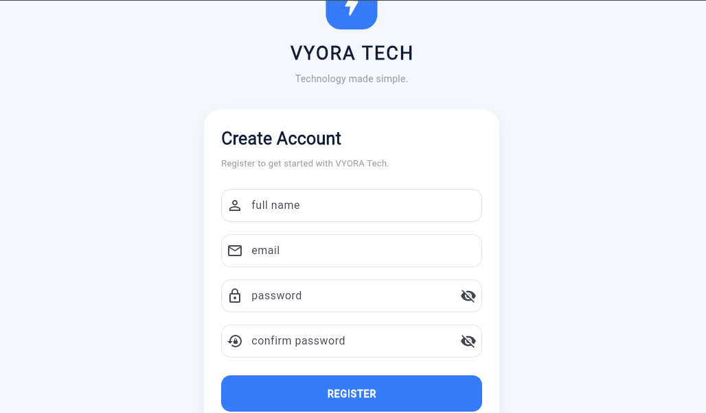

# VYORA Tech

VYORA Tech is a Flutter-based mobile application developed as a Computer Science project. The application features user authentication interfaces designed to provide users with a simple and accessible experience.

## Features

- **Login Screen:** Provides an interface for existing users to log in.
- **Registration Screen:** Allows new users to access the registration interface.
- **User-Friendly Interface:** Simple and organized mobile application design.

## Screenshots

### Login Screen


### Registration Screen



## Technologies Used

- Flutter
- Dart
- Android Studio
- Visual Studio Code
- Git
- GitHub

## Installation and Setup

To run this project on your computer:

1. Clone the repository:

   ```bash
   git clone https://github.com/Vicky2008ll/vyora_tech.git
   ```

2. Enter the project directory:

   ```bash
   cd vyora_tech
   ```

3. Install the dependencies:

   ```bash
   flutter pub get
   ```

4. Run the application:

   ```bash
   flutter run
   ```

## Project Repository

[GitHub Repository – VYORA Tech](https://github.com/Vicky2008ll/vyora_tech)

## Author

**Victory Francis Erioluwa**

Computer Science Department
